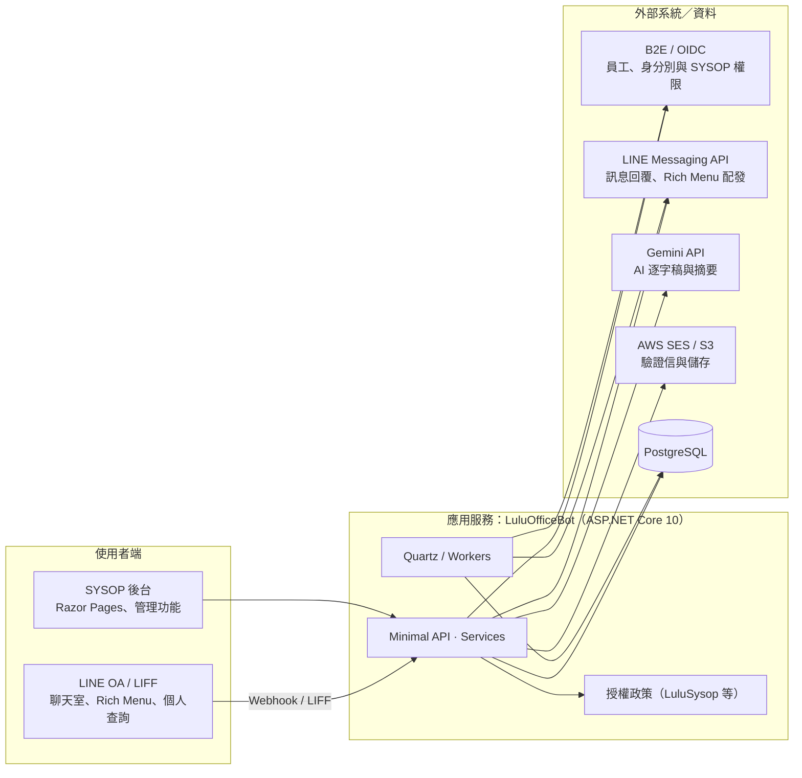

# 小露AI｜LINE OA 開發規格書 — 總覽

Nov 20, 2026 · chimoon 高千月 · 全電商技術處

| 項目 | 內容 |
| --- | --- |
| 文件版本 | v1.1（2026-11-20：新增 10 業務功能、11 樣式說明書；後台登入對齊 UAT OIDC 頁） |
| 基準程式版本 | TechAI20261116.zip |
| 主要依據 | `小露AI_LINEOA_20261119.md`（11/19 內部開發說明 SA） |
| 參考文件 | `參考_既有規格書/`（關聯規格 v0.2、綁定規格 v1.0、測試規格 v2.0、事件路由 v0.1、畫面規格 v0.5、B2E 身份 API／快照事件 v1.0、網路架構 v0.1） |
| 適用對象 | 小露後端／前端開發、B2E 串接窗口、QA、INFRA |

> 本系列規格以 11/16 程式實作為準重新整理。SA 未載明的程式細節（欄位型別、API 路徑參數等）標示「以程式碼為準」或列入待確認，**不在規格中自行假設**。

---

## 1. 文件清單

| # | 文件 | 範圍 | 狀態 |
| --- | --- | --- | --- |
| 00 | 小露AI_開發規格書_總覽.md（本文件） | 架構、技術棧、名詞、與舊規格差異、全域待確認 | — |
| 01 | 01_LINE帳號綁定_開發規格書.md | LIFF → 員編 → B2E 查核 → 公司 Email 驗證 → 綁定 | 已實作 |
| 02 | 02_身份狀態與RichMenu配發_開發規格書.md | Status／Identity 判斷、選單切換、異動同步 | 已實作 |
| 03 | 03_語音逐字稿與摘要_開發規格書.md | 語音接收、Access Guard、Gemini、結果查詢 | 已實作（有可靠性風險） |
| 04 | 04_每日日結摘要_開發規格書.md | 18:00 排程、彙整區間、Recovery、手動日結 | 已實作 |
| 05 | 05_SYSOP管理後台_開發規格書.md | 後台登入、語音／日結管理、Rich Menu 生命週期 | 已實作（MFA 待驗收） |
| 06 | 06_事件路由與圖文選單動作_開發規格書.md | MESSAGE／URI／POSTBACK 處理、事件路由 | 部分實作（Postback 業務分流未做） |
| 07 | 07_B2E串接_開發規格書.md | B2E 查核 API、OIDC（後台）、Kafka 快照、Reconcile、業務 API | 已實作（業務 API 規劃中） |
| 08 | 08_查詢商品_開發規格書.md | 全聯採購／廠服 查詢商品 | 下一階段（規劃中） |
| 09 | 09_小露_B2E_網路架構.md／.html | 網路分區與 6 條通道；沿用 B2E 既有 API，不另開 Gateway | v0.2（11/19 調整） |
| 10 | 10_LINEOA_B2E業務功能_開發規格書.md | 查詢商品、查詢特賣、代理加減量、活動鎖檔、全聯檔期、商談回覆 | v1.1（規劃中） |
| 11 | 11_小露_UI樣式說明書.md | 三套介面的色彩、字體、版面、元件與寫作規則 | v1.0 |

### 1.1 交付資料夾結構

| 資料夾 | 內容 |
| --- | --- |
| `lineoa` | LINE 使用者端操作頁面（LIFF 綁定、業務功能操作示意、圖文選單圖片） |
| `lineoa_backend` | 小露後台頁面（B2E OIDC 登入、每日語音、日結摘要、LINE OA 圖文選單、事件路由） |
| `lineoa_b2e` | B2E 後台「LINEOA 身份維護」頁面（屬 B2E 系統） |
| `sa` | 開發規格書（00–11）、樣式說明書、SA 簡報稿、`參考_既有規格書` |

---

## 2. 系統運行架構

ASP.NET Core 為核心，單一 .NET 應用承接 LINE、B2E、AI、資料與背景工作。

**非同步工作**

| 工作 | 用途 |
| --- | --- |
| Kafka Consumer | 接收 B2E 人員快照 `PXB2E.Internal.MemberSnapshotChanged`，同步 Status／Identity |
| Reconcile Job | 與 B2E 對帳，補 Kafka 漏收或舊蓋新 |
| LineRichMenuSyncWorker | 身份異動後補同步 Rich Menu、配發失敗重試 |
| Quartz DailyReportJob | 每日 18:00 日結 |
| DailyReportRecoveryWorker | 補跑缺漏日結 |

---

## 3. 技術棧

| 層 | 技術 |
| --- | --- |
| Web／API | ASP.NET Core 10、Minimal API、Razor Pages（後台） |
| 排程／背景 | Quartz.NET、Hosted Workers |
| 資料庫 | PostgreSQL |
| LINE | Messaging API（Webhook、Reply／Push、Rich Menu）、LIFF |
| 身份 | B2E 員工資料 API、B2E OIDC（僅後台 SSO）、Kafka 人員快照 |
| AI | Gemini API（音訊辨識＋摘要） |
| 雲端服務 | AWS SES（驗證信）、AWS S3（儲存） |

---

## 4. 兩個授權主體（重要）

| | A｜LINE OA 員工綁定 | B｜SYSOP 後台登入 |
| --- | --- | --- |
| 授權主體 | LINE User ID ↔ 員工 | B2E 帳號 |
| 驗證方式 | LINE ID Token → 員編 → B2E 查核 → 公司 Email 一次性驗證 | B2E OIDC SSO |
| 條件 | Status=1、Type=1、有 LINE OA 身份 | Status=1、Type=1、LINE OA Identity=90 |
| 結果 | 建立 `sys_line_bindings`、配發身份選單 | 簽發後台 Cookie |

- SYSOP **不需要**先綁定 LINE；綁定 LINE **不會**間接取得後台權限。
- Rich Menu 只是入口，**不是安全控管**；所有功能端（Webhook、LIFF API、後台頁）都要重新驗證身份與權限。

---

## 5. 名詞

| 名詞 | 說明 |
| --- | --- |
| Status | B2E 帳號狀態：1 啟用／2 停用／9 離職（刪除） |
| Type | B2E 人員類型；SA 中綁定與後台均要求 Type=1（語意以 B2E 定義為準） |
| LINE OA Identity | B2E「LINEOA 身份」：10 基本使用者／20 全聯採購／30 全電商MD／40 全聯行銷／50 廠服／90 小露SYSOP；null＝無資格 |
| UNBOUND | 未綁定使用者選單（LINE default rich menu） |
| BOUND_GENERAL | 已綁定一般使用者選單；身份無指定選單時使用 |
| IDENTITY | 指定給某 B2E LINE OA 身份的選單 |
| Binding Session | 綁定流程暫存工作階段（LINE ID Token 驗證後建立） |
| Access Guard | 語音等功能入口的綁定＋B2E 狀態檢查 |

---

## 6. 與既有規格差異（以本系列為準）

| 主題 | 既有規格 | 11/16 實作（本系列） |
| --- | --- | --- |
| 綁定主流程 | 員編 → 導向 B2E OIDC／PKCE → OIDC Email 比對 → Email 驗證 | LINE ID Token → 員編 → **B2E 即時查核（API）** → 公司 Email 一次性驗證；**不跳 B2E OIDC 網站** |
| 綁定條件 | 在職＋OIDC claim `line_oa_identity` | Status=1、Type=1、LINE OA 身份（自 B2E 查核取得） |
| 框架 | .NET 8 | ASP.NET Core 10、Minimal API、Razor Pages |
| 語音辨識 | Google Speech-to-Text ＋ Gemini | Gemini 一次完成逐字稿與摘要 |
| 結果文件 | 寫入 Google Doc，回傳 URL | PostgreSQL 保存；以私人連結／LIFF 或後台報表查詢；儲存用 S3 |
| 驗證信 | 未指定 | AWS SES |
| 後台登入 | 帳號／密碼／Token mock | B2E OIDC `/signin-oidc-backoffice`，Identity=90，8 小時絕對到期 |
| 選單綁定身份 | 寫死「採購／商企／廠服／其他」 | UNBOUND／BOUND_GENERAL／IDENTITY；IDENTITY 對應 B2E 身份 |
| Status=2 選單 | 關聯規格 v0.2：維持原選單 | 相同：保留選單，功能端拒絕 |
| Status=9 | 立即解綁 | 移除個人選單、退回預設（解除綁定） |
| Postback | 事件路由規格定義 Postback 路由 | 選單設定支援 POSTBACK，**Webhook 尚未做業務分流** |
| 推播 F3（商品中台推播 API） | 架構 Outline §5 | SA 未提及，**不在 11/16 範圍** |
| 小露 ↔ B2E 業務串接 | 網路架構 v0.1：另開小露專屬 Gateway／內網 listener＋獨立 Adapter，mTLS＋HMAC | 網路架構 v0.2：**不另開 Gateway**，小露直連 B2E 既有 API 服務，沿用系統 Bearer token＋IP 白名單 |

---

## 7. 已知風險

| # | 風險 | 說明 | 對應文件 |
| --- | --- | --- | --- |
| K1 | 語音背景處理使用 `Task.Run` | 程序重啟時處理中語音可能遺失；**佇列尚未完整持久化** | 03 |
| K2 | SYSOP MFA 信任證據 | 需安全落實並驗收 | 05 |
| K3 | Kafka 舊蓋新 | B2E 不保證快照順序；依 Reconcile 收斂 | 02、07 |
| K4 | Rich Menu 非安全控管 | URI 動作可繞過選單，功能端需各自驗證 | 02、06 |
| K5 | 個人 OA 與群組資料隔離 | 個人 OA 語音／日結不可外洩到群組 | 03、04 |

---

## 8. 全域待確認

1. Type=1 的正式語意與 B2E 欄位來源。
2. 推播 F3（商品中台推播 API）是否仍列入後續階段。
3. 語音、日結、驗證信在 S3／PostgreSQL 的保存期限與清除政策。
4. UAT「晨間測試模式」不列入正式主流程，上線前確認已關閉。
5. 查詢商品的正式資料來源（不以 344 筆測試資料交付）。
