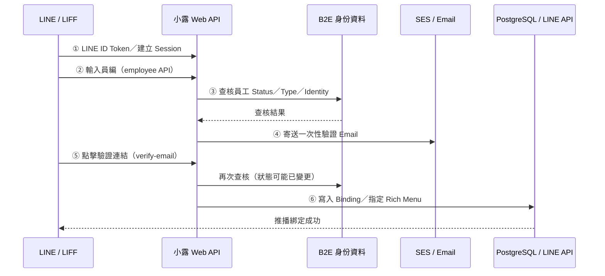

# 01｜LINE 帳號綁定 — 開發規格書

Nov 19, 2026 · chimoon 高千月 · 全電商技術處

| 項目 | 內容 |
| --- | --- |
| 版本 | v2.0（取代 `參考_既有規格書/LINE帳號綁定_開發規格書.md` v1.0） |
| 基準程式 | TechAI20261116.zip |
| 入口 | LINE OA 圖文選單「綁定帳號」→ LIFF 綁定頁 |
| 相關文件 | 00 總覽、02 身份狀態與 RichMenu、07 B2E 串接、參考：關聯規格 v0.2、測試規格 v2.0 |

## 1. 目的

讓員工把 LINE 帳號與 B2E 員工身份綁定。綁定成功後，系統依 B2E LINE OA 身份配發專屬 Rich Menu，並開放授權的語音／摘要功能。

**本版主流程為「公司 Email 一次性驗證」，不跳轉 B2E 網站做 OIDC。**（v1.0 的 OIDC／PKCE 流程不再適用於綁定。）

## 2. 使用者操作流程

| 步驟 | 使用者看到 | 系統動作 |
| --- | --- | --- |
| 01 | 點選圖文選單「綁定帳號」 | — |
| 02 | 開啟 LIFF | 取得並驗證 LINE ID Token，建立 Binding Session |
| 03 | 輸入員工編號 | 清除前後空白；送出後鎖定按鈕 |
| 04 | 顯示核對中 | B2E 即時查核 Type、Status、LINE OA 身份 |
| 05 | 提示已寄出驗證信（Email 遮罩） | 寄出一次性連結（AWS SES） |
| 06 | 點 Email 連結 | 驗證 Token，寫入正式 Binding |
| 07 | LINE 收到成功通知 | 配發身份專屬 Rich Menu；可進入授權的語音／摘要功能 |

驗證碼過期、員工狀態變更或身份不符時，**不可完成綁定，必須重新驗證**。

## 3. 時序

## 4. 業務規則

| 編號 | 規則 |
| --- | --- |
| B1 | LINE User ID 一律由後端驗證 LINE ID Token 取得；**不信任前端傳入的 User ID**。 |
| B2 | 已有有效綁定的 LINE 帳號重新開啟 LIFF，顯示「您已完成綁定」，不重複建檔、不寄信。 |
| B3 | 員工須同時符合 Status=1、Type=1、LINE OA 身份非 null，才寄驗證信。 |
| B4 | Status 2／9、查無員編 → 不寄信、不綁定（錯誤代碼見 §6）。 |
| B5 | 身份 null（B2E「未設定」）→ 拒絕綁定；不可視為 10 基本使用者。 |
| B6 | 驗證連結一次有效、有時效（v1.0 定 30 分鐘，正式值以程式設定為準）；過期、已使用、重寄後的舊連結皆失效。 |
| B7 | 點擊驗證連結時**再查核一次 B2E**；期間狀態或身份變更則不完成綁定。 |
| B8 | 驗證成功才寫入 `sys_line_bindings`（之前僅存在於 Binding Session）。 |
| B9 | 一個 LINE User ID 只能綁定一位員工；一位員工的多 LINE 帳號規則以程式碼為準（待確認）。 |
| B10 | 重寄驗證信有頻率限制；查核失敗類錯誤要限流，避免員編枚舉。 |
| B11 | 綁定成功、失敗、解除皆寫稽核紀錄。 |

## 5. 畫面

| 畫面 | 重點 |
| --- | --- |
| LIFF 載入 | 「正在透過 LIFF 取得您的 LINE 身份資訊…」 |
| 已綁定 | 「您已完成綁定」，不顯示員編欄位 |
| 輸入員編 | 單欄表單、LINE 綠主按鈕；送出後顯示核對中，不可重複送出 |
| 驗證信已寄出 | 遮罩 Email（如 `ch***o@pxmart.com.tw`）、剩餘時間、重新發送（限頻） |
| 驗證結果（瀏覽器） | 成功：「帳號綁定驗證成功」，提示回 LINE；失敗：「驗證連結無效或已過期」 |
| LINE 通知 | 綁定完成訊息＋身份選單生效 |

> 互動原型：`lineoa/01_帳號綁定/LINE_LIFF_綁定帳號_網頁原型.html` v2.0（2026-11-20 依本規格更新，含 7 種情境：正常、已綁定、查無／離職、停用、身份 null、連結失效、驗證期間狀態變更）。

## 6. 錯誤代碼

| 代碼 | 情境 | 使用者訊息方向 |
| --- | --- | --- |
| EMP_NOT_FOUND | 查無員編、Status≠1、Type≠1 | 無法驗證此員工編號（不揭露原因細節） |
| NO_LINEOA_IDENTITY | B2E 身份為 null | 目前無小露使用資格，請洽管理員 |
| TOKEN_INVALID | 驗證連結過期／已使用／被取代 | 驗證連結無效或已過期，請回 LINE 重新申請 |
| STATUS_CHANGED | 驗證時 B2E 狀態或身份已變更 | 需重新驗證 |
| ALREADY_BOUND | 已綁定 | 您已完成綁定 |

錯誤回應帶 `correlation_id` 供稽核。實際代碼名稱以程式碼為準；v1.0 的 `OIDC_EMAIL_NOT_FOUND`、`IDENTITY_MISMATCH`（OIDC 比對）在本流程不再使用。

## 7. 資料

| 資料 | 說明 |
| --- | --- |
| Binding Session | LINE User ID、員編、查核結果、Email Token 雜湊、到期時間；短效 |
| `sys_line_bindings` | LINE User ID、員編、綁定狀態、B2E Status、Identity Id／名稱、目前 Rich Menu、解除原因、綁定／解除時間（欄位見參考：關聯規格 v0.2 §5，以程式碼為準） |
| 稽核紀錄 | 綁定、失敗、解除事件 |

- Email Token 為不可預測亂數，DB 只存雜湊。
- 畫面與 log 中 Email 遮罩。

## 8. 解除綁定

| 觸發 | 結果 |
| --- | --- |
| B2E Status=9（離職） | 解除綁定、移除個人選單、退回預設；不可再綁 |
| B2E 身份變 null | 等同解綁；B2E 重新指派身份後需重新綁定 |
| 使用者／管理者解除 | 是否提供與入口待確認 |

詳見 02。

## 9. 驗收條件

- 未綁定帳號可完成：LIFF → 員編 → B2E 查核 → Email 驗證 → 綁定 → 收到成功通知與身份選單。
- 已綁定帳號重開 LIFF 顯示已完成，不重複建檔。
- Status 2／9、查無員編、身份 null 均無法寄信與綁定。
- 過期／已使用／被取代的連結無法完成綁定。
- 寄信後到點連結之間 B2E 狀態變更，綁定不成立。
- 連點送出只寄一封信；重寄有頻率限制。
- 對應測試案例：測試規格 v2.0 LINE-05～LINE-13、LINE-19、LINE-22（LINE-09 改為不適用，需改寫測試規格）。

## 10. 待確認

1. 驗證連結有效期限正式值（v1.0 為 30 分鐘）。
2. 同一員工可否綁定多個 LINE 帳號。
3. 使用者自行解除綁定的入口與權限。
4. 錯誤代碼正式名稱與訊息文案。
5. 測試規格 v2.0 依新流程改版（移除 OIDC 相關步驟）。
