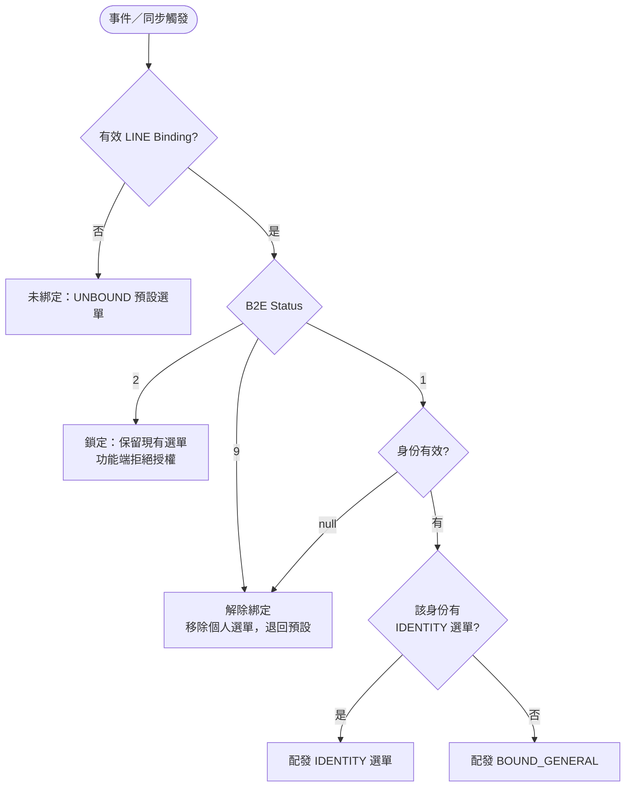

# 02｜身份狀態與 Rich Menu 配發 — 開發規格書

Nov 19, 2026 · chimoon 高千月 · 全電商技術處

| 項目 | 內容 |
| --- | --- |
| 版本 | v1.0 |
| 基準程式 | TechAI20261116.zip |
| 主要元件 | RichMenuManagementService、LineRichMenuSyncWorker、Kafka Consumer、Reconcile Job |
| 相關文件 | 01 綁定、05 後台（選單維護）、07 B2E 串接；參考：關聯規格 v0.2 |

## 1. 目的

依「綁定狀態 × B2E Status × LINE OA 身份」決定使用者看到哪個 Rich Menu、能否使用功能，並在 B2E 異動時自動同步。

## 2. 選單類型

| 類型 | 適用 | 說明 |
| --- | --- | --- |
| UNBOUND | 未綁定、Status 9、身份 null | LINE 預設選單（半版 2 格：綁定帳號／關於小露） |
| BOUND_GENERAL | 已綁定、身份無指定選單 | 一般使用者選單 |
| IDENTITY | 已綁定、身份有指定選單 | 指定給 B2E LINE OA 身份（如 20 全聯採購全版 6 格、50 廠服全版 4 格） |

身份 → 選單的對應存在後台（`sys_line_rich_menu_assignments`），不寫死在程式；新身份未設定時自動用 BOUND_GENERAL。

## 3. 判斷流程

## 4. 狀態矩陣

| # | 綁定 | Status | 身份 | 選單 | 功能 | 處理 |
| --- | --- | --- | --- | --- | --- | --- |
| A | 未綁定 | — | — | UNBOUND | 綁定帳號、關於小露 | 其他操作回覆「請先綁定帳號」 |
| B | 已綁定 | 1 | 有效 | IDENTITY → 無則 BOUND_GENERAL | 該身份功能 | 正常 |
| C | 已綁定 → 未綁定 | 1 | null | UNBOUND | 同 A | 等同解綁 |
| D | 已綁定 | 2 | 保留 | 維持原選單 | 全部拒絕 | 回覆凍結訊息 |
| E | 已綁定 → 未綁定 | 9 | 清除 | 退回預設 | 同 A | 立即解除綁定 |

凍結訊息（沿用關聯規格 v0.2）：`您的帳號目前凍結了，請洽小露祕書服務人員。`

## 5. 業務規則

| 編號 | 規則 |
| --- | --- |
| R1 | 有效身份優先 IDENTITY 選單；無指定才用 BOUND_GENERAL。 |
| R2 | Status 2 保留畫面但禁止功能；Status 2→1 自動解凍，不需重綁。 |
| R3 | Status 9 解除綁定與專屬選單；離職員編不可再綁。 |
| R4 | 身份 null ＝ 無資格，等同解綁；不得當成 10 基本使用者。 |
| R5 | **Rich Menu 不是安全控管**：Webhook、LIFF API、URI 目的頁都要各自重驗綁定與 B2E 狀態。 |
| R6 | B2E 刪除／停用身份時，B2E 會把人員改為 10；小露依快照切換為 10 的選單。 |
| R7 | 不長期快取 identity_id → 名稱（B2E Id 可重用、名稱可改），以最新快照為準。 |
| R8 | 主動推播前同樣檢查：Status 2 不推、Status 9 已解除不推。 |

## 6. 配發與同步

| 機制 | 說明 |
| --- | --- |
| RichMenuManagementService | 呼叫 LINE Messaging API：link／unlink 使用者選單、設定預設選單 |
| Kafka Consumer | 收 B2E 人員快照即時更新 Status／身份並觸發選單切換 |
| Reconcile Job | 與 B2E 對帳，修正漏收或順序錯亂（B2E 不保證快照順序） |
| LineRichMenuSyncWorker | 身份選單指定變更時批次同步現有綁定員工；配發失敗重試 |

- 快照為完整資料，直接覆蓋，處理需冪等。
- 不可用 `MemberUpdateOn` 或 `Uuid` 判斷新舊而丟棄訊息（B2E 規格 §2.2）。

## 7. 資料

| 資料表 | 用途 |
| --- | --- |
| `sys_line_bindings` | 綁定狀態、B2E Status、身份、目前選單、解除原因（RESIGNED／NO_IDENTITY 等） |
| `sys_line_rich_menu_assignments` | B2E LINE OA 身份 → Rich Menu 的指定 |
| Rich Menu 主檔 | 草稿／發布、`LineRichMenuId`（見 05） |

欄位細節以程式碼為準。

## 8. 驗收條件

- 綁定後依身份顯示 IDENTITY 選單；身份未設定選單時顯示 BOUND_GENERAL。
- B2E 改身份後，快照到達即切換選單，無需重新加好友。
- Status=2：選單不變，文字、語音、選單各格、LIFF API 皆被拒並回凍結訊息；改回 1 後恢復。
- Status=9 或身份 null：立即解除綁定並回到 UNBOUND。
- Kafka 停止期間的異動，由 Reconcile 補正。
- 對應測試：測試規格 v2.0 LINE-13～LINE-23。

## 9. 待確認

1. 凍結期間是否改用專用「凍結選單」（目前：維持原選單）。
2. 離職／身份取消解除時是否推播告知（目前：不推播）。
3. Reconcile Job 執行頻率。
4. 90 小露SYSOP 在 LINE 前台的選單（比照 10 或另設）。
