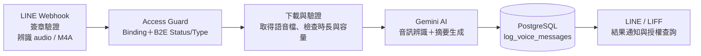

# 03｜語音逐字稿與摘要 — 開發規格書

Nov 19, 2026 · chimoon 高千月 · 全電商技術處

| 項目 | 內容 |
| --- | --- |
| 版本 | v1.0 |
| 基準程式 | TechAI20261116.zip |
| 使用範圍 | 個人 OA（1 對 1）與符合條件的 LINE 群組 |
| 相關文件 | 02 身份狀態、04 日結、05 後台；參考：畫面規格 v0.5 §3–4、架構 Outline §4 |

## 1. 使用者操作流程

| 步驟 | 使用者 | 系統 |
| --- | --- | --- |
| ① 傳送語音 | LINE 錄音訊息或 M4A 檔案 | Webhook 接收 |
| ② 系統先驗證 | — | 綁定＋B2E 即時狀態 |
| ③ 收到接收提示 | 個人：立即回覆；群組：通知節流 | — |
| ④ AI 處理 | — | Gemini 產生逐字稿與摘要 |
| ⑤ 查詢結果 | 私人連結／LIFF 或後台報表 | 依身份與來源控制可見範圍 |

**限制**：預設上限 30 分鐘、32 MB；可由設定調整，但程式有硬上限。

**結果內容**：摘要標題、逐字稿、摘要內容、來源／時間。

## 2. 後端運作

1. 驗證 `X-Line-Signature`；只處理 audio 訊息與 M4A 檔案，圖片、貼圖不觸發。
2. Access Guard：確認有效綁定與 B2E Status=1、Type=1。未綁定回「請先綁定帳號」；Status 2 回凍結訊息。
3. 向 LINE 取得媒體，檢查時長與容量，超過上限回覆提示，不送 AI。
4. 送 Gemini 產生逐字稿與摘要；**AI 完成前後都再查 B2E**，期間被停用或離職則不發送結果。
5. 寫入 `log_voice_messages`，通知使用者。

## 3. 個人與群組

| 項目 | 個人 OA | 群組 |
| --- | --- | --- |
| 接收提示 | 立即回覆 | 節流，避免洗版 |
| 完成通知 | 回覆私人結果連結 | 依群組通知策略 |
| 資料可見 | 僅本人與授權範圍 | 群組範圍 |
| 隔離 | **個人 OA 資料不可外洩至群組** | — |

「符合條件的群組」判定規則以程式碼為準（待確認）。

## 4. 摘要結構

依架構 Outline §4.2 的結構（以程式實作為準）：

| 區塊 | 內容 |
| --- | --- |
| 摘要標題 | AI 一句話標題 |
| 今日進度 | 條列 |
| 待追蹤事項 | 事項／負責人／期限 |
| 需確認事項 | 條列 |
| 逐字稿 | 全文 |

摘要標示「AI 產出，待負責人確認」。

## 5. 資料

`log_voice_messages`（欄位以程式碼為準；畫面規格 v0.5 曾提出需補：語音標題、原始檔名）。

保存：原始語音存放（S3／暫存）與清除期限待確認。

## 6. 已知風險

| 風險 | 說明 | 建議 |
| --- | --- | --- |
| `Task.Run` 背景處理 | 程序重啟或部署時，處理中的語音可能遺失；**佇列尚未完整持久化** | 改為持久化佇列或以 DB 狀態＋Worker 補跑；SA 與對外說明不宣稱已持久化 |
| AI 處理時間 | 長音檔逾時 | reply token 約 1 分鐘，完成結果改用 push |

## 7. 驗收條件

- 綁定且 Status=1 的使用者傳 10～20 秒語音，收到接收提示，完成後可查到標題、逐字稿、摘要。
- 未綁定傳語音回「請先綁定」；Status=2 回凍結訊息；皆不送 AI。
- 超過 30 分鐘或 32 MB 回覆提示，不送 AI。
- 處理中被 B2E 停用／離職，結果不發送。
- 群組連續傳多則語音，提示有節流。
- 個人 OA 的語音不出現在群組結果或群組日結。
- 對應測試：測試規格 v2.0 VOICE-01～VOICE-08。

## 8. 待確認

1. 群組可使用的條件（群組白名單、成員須綁定等）。
2. 群組通知節流規則。
3. 原始語音與結果的保存期限；敏感資訊遮罩是否實作。
4. `Task.Run` 改善排程。
