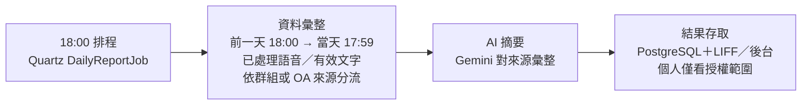

# 04｜每日日結摘要 — 開發規格書

Nov 19, 2026 · chimoon 高千月 · 全電商技術處

| 項目 | 內容 |
| --- | --- |
| 版本 | v1.0 |
| 基準程式 | TechAI20261116.zip |
| 主要元件 | Quartz DailyReportJob、DailyReportRecoveryWorker |
| 相關文件 | 03 語音、05 後台；參考：畫面規格 v0.5 §5–6 |

## 1. 流程

## 2. 規則

| 編號 | 規則 |
| --- | --- |
| D1 | 每日 18:00 觸發，為正式業務結算時間。 |
| D2 | 彙整區間：前一天 18:00:00 ～ 當天 17:59:59；**以結束日為日結日期**。 |
| D3 | 來源：已處理完成的語音與有效文字；依「群組」或「個人 OA」分流，各自產生日結。 |
| D4 | 摘要內容：今日進度、待追蹤、待確認、風險。 |
| D5 | 群組日結以推播通知；個人 OA 日結以 LIFF 查詢。兩種模式不同。 |
| D6 | 個人 OA 資料不可外洩至群組日結。 |
| D7 | DailyReportRecoveryWorker 補跑缺漏的日結。 |
| D8 | SYSOP 可手動執行日結；**手動執行不等同自動推播**（是否推播以程式碼為準）。 |
| D9 | UAT 特殊晨間測試模式不屬主流程，正式環境不可啟用。 |

## 3. 查詢

| 管道 | 對象 | 範圍 |
| --- | --- | --- |
| LIFF | 個人 | 本人授權範圍 |
| 後台（05） | SYSOP | 日結摘要列表／內容、手動日結 |

畫面欄位沿用畫面規格 v0.5 §5–6（LINE 群暱稱、日結時間、建立時間、摘要全文、WORD 匯出），實作欄位以程式碼為準。

## 4. 驗收條件

- 18:00 產生日結，區間為前日 18:00～當日 17:59:59，日期顯示結束日。
- 群組與個人 OA 日結分開，個人內容不出現在群組。
- 排程失敗或停機錯過時，Recovery Worker 補產。
- SYSOP 手動執行可產生日結，不重複推播（依實作確認）。
- 無資料的來源不產生空日結（依實作確認）。
- 對應測試：測試規格 v2.0 VOICE-11。

## 5. 待確認

1. 手動日結是否推播、是否覆蓋同日既有日結。
2. 無語音／文字時是否產生空日結。
3. 日結保存期限。
4. 「有效文字」的判定（是否排除指令、貼圖等）。
