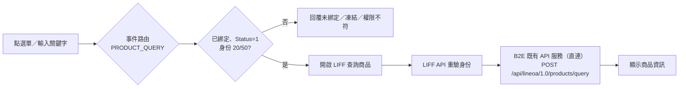

# 08｜全聯採購／廠服 查詢商品 — 開發規格書（規劃中）

Nov 19, 2026 · chimoon 高千月 · 全電商技術處

| 項目 | 內容 |
| --- | --- |
| 版本 | v0.1（下一階段規劃） |
| 狀態 | 介面規劃中，未列入 TechAI20261116 |
| 原型 | `lineoa/06_LINE功能操作/小露_LINEOA_功能操作示意.html`（前版：`lineoa/02_查詢商品`） |
| 相關文件 | 06 事件路由、07 B2E 串接、09 小露 × B2E 網路架構 v0.2、**10 業務功能（查詢商品 §1 為最新欄位定義）**；參考：事件路由 v0.1 |

## 1. 範圍

| 項目 | 內容 |
| --- | --- |
| 對象 | 20 全聯採購、50 廠服（30／40 是否開放待確認） |
| 入口 | 身份專屬圖文選單「查詢商品」、關鍵字「查詢商品／查商品」（路由 PRODUCT_QUERY） |
| 聊天室 | 預設僅 1 對 1 |
| 介面 | LIFF（數字鍵盤輸入貨號、主圖、查詢結果） |

## 2. 流程

## 3. 查詢內容（依網路架構 v0.2）

走 B2E 既有 API 服務，不另開 Gateway；認證沿用 B2E 系統 Bearer token。

| 功能 | 建議路徑 | 類型 |
| --- | --- | --- |
| 商品基本資料／狀態／可銷量 | `POST /api/lineoa/1.0/products/query`（全聯貨號／全聯條碼／平台編號／生鮮呼出碼 擇一＋員編） | 讀 |
| 變價（銷售門市、取貨門市、活動起迄、限量） | `/api/lineoa/1.0/price-changes/query` | 讀 |

查詢結果欄位依 B2E 正式 API 定義。

## 4. 規則

- LIFF API 須重驗綁定與 B2E 狀態（不依賴選單）。
- 商品資料來源須經業務／IT 提供，**不以 344 筆測試資料交付**。
- LINE reply token 約 1 分鐘有效；查詢走 LIFF 頁面同步顯示。

## 5. 待確認

1. 商品正式資料來源與 B2E API 規格。
2. 30 全電商MD、40 全聯行銷是否開放。
3. 查詢結果欄位與廠服可見範圍（廠服是否僅看自家商品）。
4. B2E 既有 API 的正式路徑前綴與 token（見 07 §5、09 待確認）。
