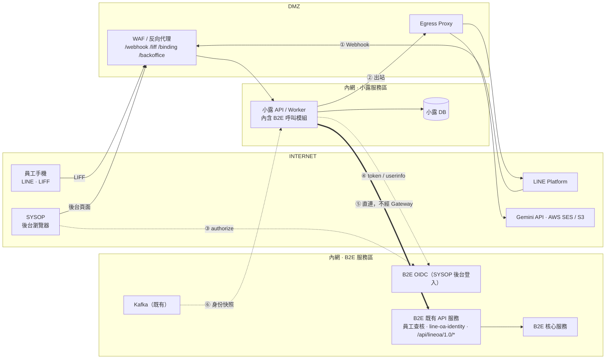

技術處辦公室自動化 · 小露 LINEOA · v0.2 · 2026-11-19

# 小露 × B2E 網路架構

作者：chimoon 高千月 · 全電商技術處

小露直接沿用 B2E 既有 API 服務串接，**不另開小露專屬 Gateway／業務通道**。員工查核、身份對帳，以及後續商品查詢、變價查詢、採購加減量、變價鎖檔，都走同一個 B2E 既有入口。

## 結論先講

- **不另開 Gateway、不設小露 Adapter。** 小露 API／Worker 直接呼叫 B2E 既有 API 服務；業務 API（`/api/lineoa/1.0/*`）由 B2E 掛在既有服務上，與身份查詢 API 同一入口、沿用 B2E 系統對系統 Bearer token。
- **OIDC 只用於 SYSOP 後台登入。** 依 11/16 實作，LINE 綁定改走「員編 → B2E 查核 → 公司 Email 驗證」，不經 OIDC；OIDC 仍不承載任何業務授權。
- **使用者身分以「代理呼叫」帶入，由 B2E 重驗。** 小露送出 MemberId，B2E 每次請求檢查帳號狀態與 LINEOA 身份；寫入類作業（加減量、鎖檔）另加冪等鍵與稽核。

## 系統架構與網路分區



小露 API／Worker 以 ⑤ 直接連 B2E 既有 API 服務，員工查核、身份對帳與業務 API 共用同一入口與系統 token；小露端不另設 Adapter 服務，B2E 端不另起 listener。小露位置以「同一機房／VPC 內網」為前提，若部署在雲端需另加 site-to-site VPN（見待確認 1）。

## 各通道網路設定

| # | 通道 | 來源 → 目的 | 協定 / Port | 曝露面 | 認證 / 防護 | 設定方 |
| --- | --- | --- | --- | --- | --- | --- |
| 1 | LINE Webhook 入站 | LINE Platform → WAF → 小露 API | HTTPS 443 | Internet 入站 | X-Line-Signature（HMAC）。LINE 未公開固定來源 IP，入站無法靠 IP 白名單 | 網管（WAF/DNS/憑證） |
| 2 | 小露出站 | 小露 → Egress → api.line.me、api-data.line.me、Gemini API、AWS SES／S3 | HTTPS 443 | Internet 出站 | Channel Access Token、各服務金鑰；Proxy 以 FQDN 白名單放行 | 網管 |
| 3 | OIDC 前端通道 | SYSOP 瀏覽器 → B2E `/connect/authorize`，callback `/signin-oidc-backoffice` | HTTPS 443 | B2E 既有公開入口 | state、PKCE；redirect_uri 白名單 | B2E（OIDC client 設定） |
| 4 | OIDC 後端通道 | 小露 API → B2E `/connect/token`、`/userinfo` | HTTPS 443 | 內網或公開入口皆可 | client_secret；只取身分（判斷 Identity=90），**不帶業務 scope** | B2E |
| 5 | **B2E 既有 API（直連）** | 小露 API／Worker → B2E 既有 API 服務（員工查核、`/api/external/1.0/line-oa-identity/member`、`/api/lineoa/1.0/*`） | HTTPS 443 | 沿用 B2E 既有 API 入口；防火牆只放行小露主機（建議內網） | B2E 系統對系統 Bearer token ＋ 來源 IP 白名單 ＋ 限流；不另設 mTLS／HMAC 專屬通道 | B2E（API、token）、網管（FW 放行） |
| 6 | 身份快照 | 小露 Worker ← Kafka broker | Kafka（SASL/TLS，port 依 B2E 提供） | 僅內網 | Consumer 帳號、group 由 B2E 發放 | B2E |

v0.1 的 ⑤「小露專屬業務通道」與 ⑦「身份對帳」在 v0.2 合併為 ⑤（同一個 B2E 既有入口）。

## v0.1 → v0.2 調整

| 項目 | v0.1（另開專屬通道） | v0.2（沿用 B2E 既有，現行） |
| --- | --- | --- |
| B2E 端入口 | 另起內網 listener／Gateway，路徑 `/api/lineoa/1.0/*` | 業務 API 掛在 B2E 既有 API 服務，與身份查詢 API 同一入口 |
| 小露端元件 | 獨立 B2E Adapter | 小露 API 內的 B2E 呼叫模組，不另設服務 |
| 認證 | mTLS ＋ API Key／HMAC（timestamp、nonce）＋ IP 白名單 | B2E 系統 Bearer token ＋ IP 白名單 |
| 綁定時用 OIDC | 是（LIFF 瀏覽器直連 authorize） | 否；OIDC 只用於 SYSOP 後台 |
| 好處 | 與其他系統隔離，可單獨斷開 | 不新增 Gateway 與憑證維運，B2E 與網管工作量少，上線快 |
| 代價／需補強 | 建置與維運成本高 | 與其他外部呼叫共用入口：限流、停用需由 B2E 依 client 區分；token 外洩影響面較大 → 靠 IP 白名單、定期輪替、稽核 |

不變的原則：業務授權不借用 OIDC；B2E 每次請求依當下資料重驗身份，不信任小露快取。

## 經 ⑤ 承載的功能

| 功能 | 路徑 | 類型 |
| --- | --- | --- |
| 員工查核（綁定）：Status／Type／LINE OA 身份 | 既有 employee API（以程式碼為準） | 讀 |
| 身份對帳／重查 | `GET /api/external/1.0/line-oa-identity/member` | 讀 |
| 查詢商品：基本資料／狀態／可銷量 | `POST /products/query`（全聯貨號／全聯條碼／平台編號／生鮮呼出碼 擇一 ＋ 員編） | 讀 |
| 查詢變價：銷售門市／取貨門市／活動起迄／限量 | `GET /price-changes?pxNo=` | 讀 |
| 採購加減量（＝供應商送審 + autopass） | `POST /purchase-adjustments` | 寫 |
| 變價鎖檔 | `POST /price-changes/{id}/lock` | 寫 |

業務路徑暫列於 `/api/lineoa/1.0` 之下，正式前綴依 B2E 既有服務規劃（待確認）。加減量與鎖檔目前只屬「20 全聯採購」；30 全電商MD、40 全聯行銷可查商品與可銷量；變價查詢的開放對象待確認。

## 請求要帶的東西

```
POST /api/lineoa/1.0/purchase-adjustments
Authorization:    Bearer {B2E 系統 token}
X-Acting-Member:  1234        ← 綁定的 B2E MemberId
X-Line-User-Id:   U1a2b…      ← 稽核用
Idempotency-Key:  7c1e…       ← 寫入類必帶
```

B2E 收到後依當下 `USR_Member` 重驗：在職、身份非 null、身份允許此功能；不信任小露端快取（身份規格 §2.3 亦建議敏感動作前重查）。

## 待確認事項

1. **小露部署位置**：與 B2E 同機房／VPC，或在雲端？若跨雲，⑤⑥ 需走 site-to-site VPN 或專線。— 網管
2. **B2E 既有 API 的正式 Base URL 與路徑**：業務 API 沿用 `/api/lineoa/1.0` 前綴，或併入 `/api/external/1.0`。— B2E 開發
3. **憑證**：業務 API 是否與身份查詢共用同一支系統 token；存放與輪替週期；來源 IP 白名單是否可設。— 資安、B2E
4. **共用入口下的限流與停用**：B2E 能否只針對小露 client 限流或停權，不影響其他呼叫方。— B2E
5. **寫入類的 create_by**：加減量、鎖檔在 B2E／SCM 記錄為「操作人 MemberId」或「系統帳號＋代理人」；autopass 是否需要另一層主管確認。— PM、SCM
6. **LINE 端確認步驟**：寫入前是否強制在 LINE 顯示確認卡片（數量、門市、起迄），避免誤觸。— PM
7. **限流與時效**：每人／每分鐘上限、B2E 回應逾時（LINE reply token 約 1 分鐘有效，查詢要在時限內回覆，否則改用 push）。— B2E、小露開發
