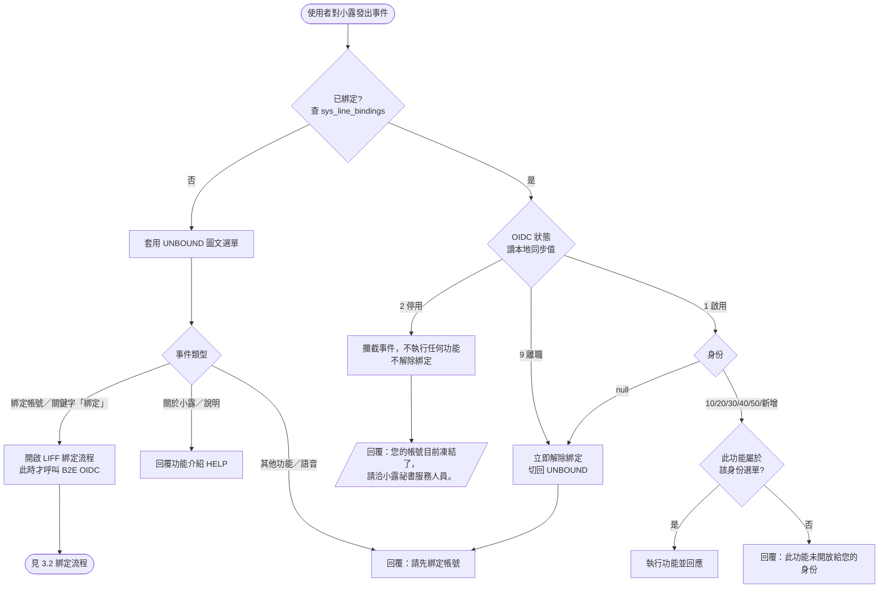
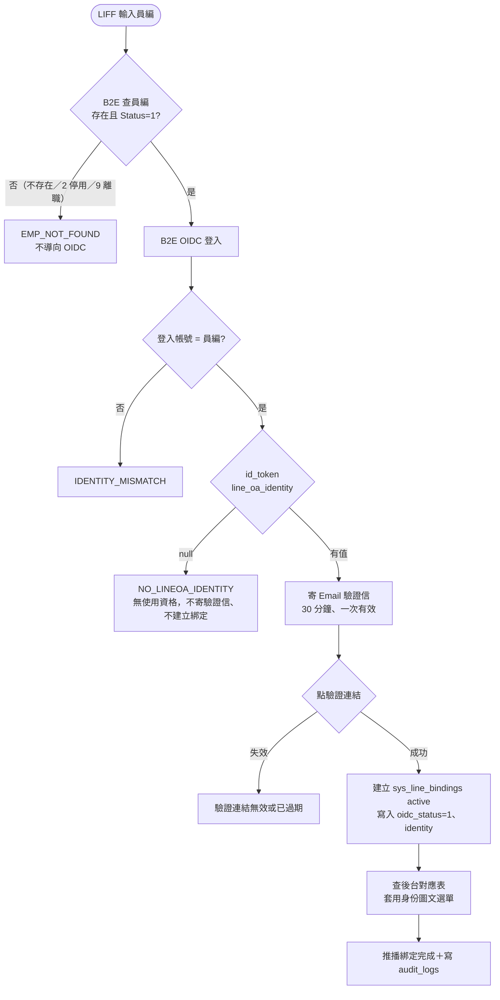
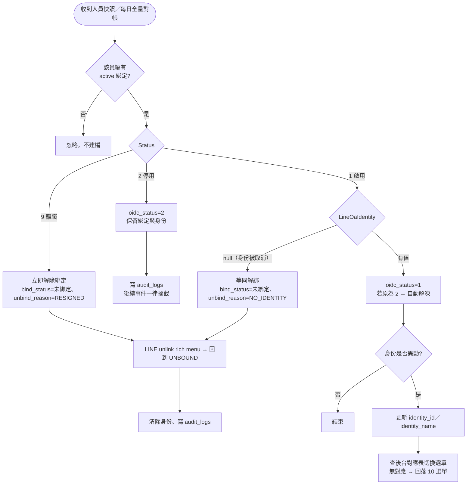
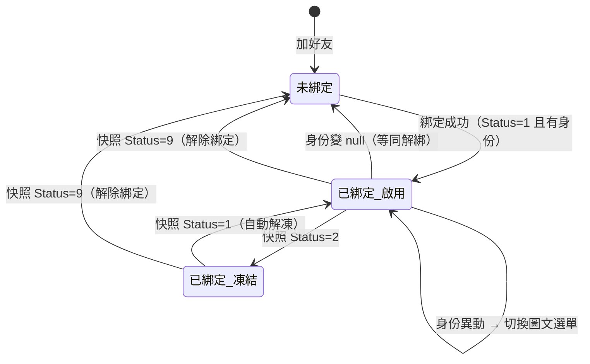

# 小露 帳號身份 × 狀態 × 綁定 關聯規格

Oct 20, 2026 · chimoon 高千月 · 全電商技術處

| 項目 | 內容 |
| --- | --- |
| 版本 | v0.2（身份 null 改為等同解綁） |
| 依據文件 | B2E_LINEOA身份API規格文件.md、B2E_人員快照事件規格文件.md、LINEOA 小露 加好友與綁定 測試規格書.md |
| 適用範圍 | LINE OA 小露所有事件（訊息、語音、Postback、圖文選單動作、LIFF 頁面）與 B2E 人員快照事件 |

---

## 1. 三個維度定義

三個維度彼此獨立，由小露端以 `sys_line_bindings` 一筆資料統一保存，決定使用者「能不能用」與「看到哪個選單」。

### 1.1 OIDC 帳號狀態（來源：B2E `Status`）

| 代碼 | 名稱 | 小露行為 |
| --- | --- | --- |
| 1 | 啟用 | 正常；依目前身份使用小露功能 |
| 2 | 停用 | **不解除綁定**；所有小露功能暫停，回覆凍結訊息 |
| 9 | 離職 | 收到事件**立即解除綁定** |

### 1.2 綁定狀態（來源：小露 `sys_line_bindings`）

| 狀態 | 說明 |
| --- | --- |
| 未綁定 | 新加好友、從未綁定、或已被解除綁定（離職） |
| 已綁定 | 完成 LIFF → B2E OIDC → Email 驗證，且綁定紀錄為 active |

### 1.3 身份類型 ＝ 圖文選單（來源：B2E `line_oa_identity`）

| 選單代碼 | 身份 | 圖文選單 | 備註 |
| --- | --- | --- | --- |
| UNBOUND | 未綁定 | 半版 2 格：綁定帳號／關於小露 | LINE default rich menu；**不呼叫 OIDC** |
| （無） | 身份 null | 不提供選單 | **帳號仍在但不可使用小露 ＝ 等同解綁**；綁定時拒絕、已綁定者解除綁定並回到 UNBOUND |
| 10 | 基本使用者 | 半版 2 格：小露語音祕書／關於小露 | 系統保留身份；其他身份被停用／刪除時自動回落為 10 |
| 20 | 全聯採購 | 全版 6 格 | |
| 30 | 全電商MD | 依小露後台設定 | |
| 40 | 全聯行銷 | 依小露後台設定 | |
| 50 | 廠服 | 全版 4 格 | |
| (新增) | B2E 新增之身份 | 由小露後台「LINE OA 圖文選單管理」綁定 | **可隨時擴充調整**；未設定選單者回落為 10 的選單 |

> **擴充原則**：身份 → 圖文選單的對應存在小露後台（設定表），不寫死在程式。以當下收到的 `identity_id` + `identity_name` 查表，不長期快取（B2E 規格：Id 可能被重用、名稱可能被修改）。
> 90 小露SYSOP 為後台操作權限，LINE OA 前台選單比照 10 或於後台另行設定。

---

## 2. 狀態組合矩陣

| # | 綁定 | OIDC 狀態 | 身份 | 圖文選單 | 可用功能 | 回覆／處理 |
| --- | --- | --- | --- | --- | --- | --- |
| A | 未綁定 | —（不查） | — | UNBOUND | 綁定帳號、關於小露 | 其他操作回覆「請先綁定帳號」 |
| B | 已綁定 | 1 啟用 | 10／20／30／40／50… | 依身份 | 該身份全部功能 | 正常回應 |
| C | 已綁定 → 未綁定 | 1 啟用 | null（被取消） | 切回 UNBOUND | 同 A | **等同解綁**：立即解除綁定、清除身份 |
| D | 已綁定 | 2 停用 | 任一（保留） | 維持原選單 | **全部暫停** | `您的帳號目前凍結了，請洽小露祕書服務人員。` |
| E | 已綁定 → 未綁定 | 9 離職 | 清除 | 切回 UNBOUND | 同 A | 立即解除綁定；之後再綁定會被擋（非在職） |

不存在的組合：

- 未綁定 + 狀態 2／9 進行綁定 → 綁定流程直接擋下（`EMP_NOT_FOUND`，見測試規格 LINE-08）。
- 已綁定 + 身份 null → 不會長期存在；綁定時拒絕（`NO_LINEOA_IDENTITY`），已綁定者收到快照即解除綁定。

---

## 3. 流程圖

### 3.1 使用者事件處理（LINE 訊息／語音／Postback／LIFF）

### 3.2 綁定流程（唯一呼叫 OIDC 的時機）

### 3.3 B2E 人員快照事件處理（Kafka `PXB2E.Internal.MemberSnapshotChanged`）

### 3.4 狀態轉移

---

## 4. 業務規則

| 編號 | 規則 |
| --- | --- |
| R1 | 未綁定前只提供 UNBOUND 選單，**不呼叫 OIDC 服務**；OIDC 只在使用者主動觸發綁定時呼叫。 |
| R2 | 綁定後依身份查後台對應表套用圖文選單；身份異動以快照為準即時切換。 |
| R2-1 | 身份 null ＝ 帳號仍在但不可使用小露，**等同解綁**：綁定時拒絕（`NO_LINEOA_IDENTITY`）；已綁定者收到快照立即解除綁定、切回 UNBOUND。B2E 重新指派身份後，使用者須重新綁定。 |
| R3 | 狀態 1：依目前身份使用小露功能。 |
| R4 | 狀態 2：**不解除綁定**、不切換選單；任何呼叫小露的功能（文字、語音、Postback、LIFF、推播觸發）皆暫停，統一回覆 `您的帳號目前凍結了，請洽小露祕書服務人員。` |
| R5 | 狀態 2 → 1：自動解凍，恢復原身份功能，無需重新綁定。 |
| R6 | 狀態 9：收到事件**立即解除綁定**、切回 UNBOUND、清除身份；已離職員編不可再綁定。 |
| R7 | 狀態檢查以本地同步值（快照＋每日全量對帳）為準，每次事件不即時打 B2E；高敏感動作（如機密推播）前可再呼叫查詢 API 確認。 |
| R8 | 凍結攔截須在後端統一入口（Webhook 與 LIFF API）實作，避免 URI 類選單動作繞過。 |
| R9 | 主動推播（例：採購通知）發送前同樣檢查：狀態 2 不推播、狀態 9 已解除不推播。 |

---

## 5. 資料欄位建議（`sys_line_bindings`）

| 欄位 | 型別 | 說明 |
| --- | --- | --- |
| line_user_id | varchar | LINE userId |
| employee_number | varchar | 員編 |
| bind_status | smallint | 1 已綁定／0 未綁定（解除） |
| oidc_status | smallint | 1 啟用／2 停用／9 離職（同步自快照） |
| identity_id | bigint null | 身份 Id；僅解除綁定後為 null |
| identity_name | varchar null | 身份名稱（以最新快照為準） |
| richmenu_id | varchar | 目前套用的 LINE rich menu ID |
| unbind_reason | varchar null | RESIGNED（離職）／NO_IDENTITY（身份取消）／USER／ADMIN |
| status_sync_on | timestamp | 最後一次快照同步時間 |
| bind_on／unbind_on | timestamp | 綁定／解除時間 |

---

## 6. 與既有文件差異

| 項目 | 既有 | 本次重新定義 |
| --- | --- | --- |
| Status=2 停用 | B2E 快照規格建議「解除綁定或停止推播」 | **不解除綁定**，改為凍結並回覆固定訊息 |
| Status=9 離職 | 建議解除綁定 | 收到事件**立即**解除綁定 |
| 身份與選單對應 | 測試規格依 5 個身份分別驗證 | 改為後台對應表，可隨時擴充；無對應回落 10 |
| 身份 null | 測試規格 LINE-12「實際行為待確認」；有「已綁定無身份」選單 | **等同解綁**：綁定時拒絕、已綁定者解除；不再使用「已綁定無身份」選單 |

## 7. 待確認

1. 凍結期間圖文選單是否改為專用「凍結選單」，或維持原選單（本版：維持原選單）。
2. 離職／身份取消解除綁定時，是否推播一則告知訊息（本版：不推播）。
